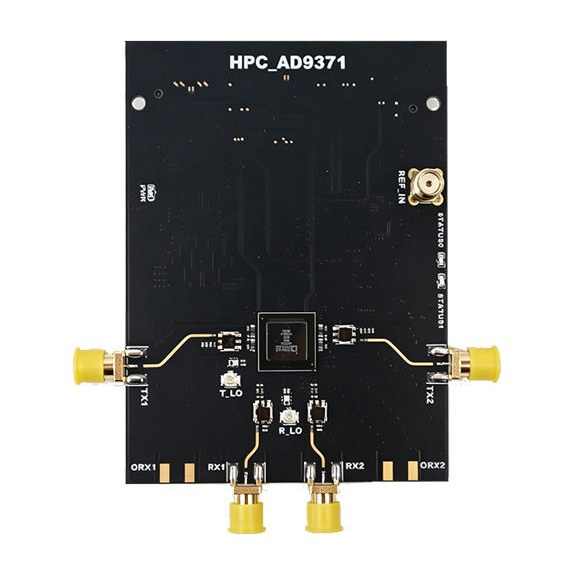
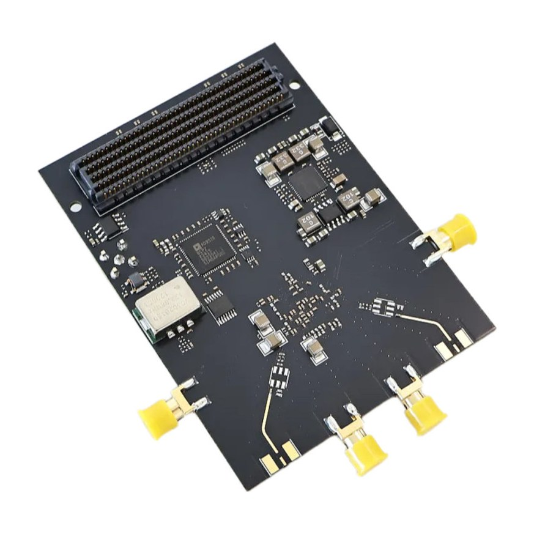

# FMC-AD9371

Hardware files and Vivado reference designs for the **OpenSourceSDRLab FMC-AD9371**, a high-performance FMC (HPC) card built around the Analog Devices AD9371 RF transceiver.

  
  

## Product link

<https://opensourcesdrlab.com/products/opensourcesdrlab-high-performance-ad9371-fmc-board-for-fpga-mezzanine-card-compatible-with-official-version>

## About the board

- RF transceiver: Analog Devices **AD9371**, with two transmit, two receive and two observation-receive channels on SMA connectors (TX1/TX2, RX1/RX2, ORX1/ORX2)
- External LO ports for the transmit and receive synthesizers (T_LO, R_LO)
- Clocking: **AD9528** clock generator with a 122.88 MHz VCXO, external reference input (REF_IN)
- Interface: FMC **HPC** connector, JESD204B and SPI to the carrier FPGA; powered from the carrier's 12 V FMC supply
- The wiring follows the Analog Devices AD9371 evaluation card, without its GPIO header, so the AD9371 reference designs from Analog Devices can be used on it
- Tested carriers: Xilinx **ZC706** (XC7Z045) and the XC7Z100 "7100" carrier
- Reference designs: Vivado/Vitis **2021.1**, bare-metal (no OS); the PL sends test tones from two DDS cores and captures the transmit and receive data in Vivado ILA cores

## Quick start

1. Fit the board on the carrier's HPC FMC connector and connect JTAG and the USB-UART console.
2. Download the prebuilt files for your carrier from the [Releases](../../releases) page.
3. Program the bitstream, run the application and watch the AD9371 come up on the console; view the receive data in the Vivado ILA.

The full steps are in the **[Quick Start Guide](docs/Quick-Start-Guide.md)** ([PDF](docs/Quick-Start-Guide.pdf)).

## Repository layout

| Path | Contents |
|---|---|
| `hardware/` | Board schematic (PDF) |
| `vivado/ZC706_122M88/` | ZC706 design with all AD9371 data paths at 122.88 MSPS: Vivado project sources (PL) and bare-metal application sources (PS) |
| `vivado/ZC706_MAX/` | ZC706 design at the AD9371's maximum data rates (receive 153.6 MSPS, transmit 307.2 MSPS) |
| `vivado/7100_MAX/` | The maximum-rate design for the XC7Z100 "7100" carrier |
| `vivado/*/FMC_AD9371_PS/ad9371/README.md` | Instructions for downloading the Analog Devices Mykonos ARM firmware header, which is not included (licence) |
| `docs/` | Quick Start Guide (Markdown and PDF) |
| `images/` | Product photos |

## Downloads (Releases)

Large files are attached to the [Releases](../../releases) page instead of being stored in the repository:

| File | Contents |
|---|---|
| `FMC-AD9371_ZC706_122M88_prebuilt_Vivado2021.1.zip` | Prebuilt files for the ZC706, 122.88 MSPS design: bitstream, ILA probes, `.xsa`, FSBL and application `.elf` |
| `FMC-AD9371_ZC706_MAX_prebuilt_Vivado2021.1.zip` | Prebuilt files for the ZC706, maximum-rate design |
| `FMC-AD9371_7100_MAX_prebuilt_Vivado2021.1.zip` | Prebuilt files for the 7100 carrier, maximum-rate design, with a `boot.bif` for building an SD-card `BOOT.bin` |
| `SHA256SUMS.txt` | SHA-256 checksums of the files above |

Check a download with `shasum -a 256 -c SHA256SUMS.txt` (macOS / Linux) or `certutil -hashfile <file> SHA256` (Windows).

## Licence

Files created by OpenSourceSDRLab are released under the [Apache License 2.0](LICENSE). Parts of the reference designs come from Analog Devices and Xilinx/AMD and remain under their own licences; see [NOTICE.md](NOTICE.md).

## Support

- Email: support@opensourcesdrlab.com
- Forum: <https://forum.opensourcesdrlab.com>
- Discord: <https://discord.gg/nnxY6DkmvT>
- Blog and user manuals: <https://blog.opensourcesdrlab.com>

---
© 2026 OpenSourceSDRLab. All rights reserved. · <a href="https://www.opensourcesdrlab.com">www.opensourcesdrlab.com</a>
